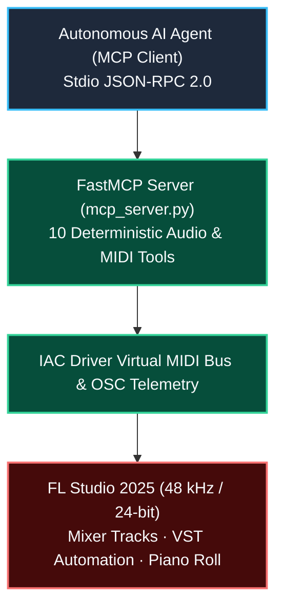

# FL Studio Native MCP Server & Telemetry Bridge

> **Real-Time Model Context Protocol (FastMCP) Server, MIDI Groove Generator & Psychoacoustic Mixing Bridge for FL Studio 2025.**

[](https://github.com/borjamoskv/flstudio-mcp/actions)
[](./LICENSE)
[](./mcp_server.py)

**Repository:** `flstudio-mcp`  
**Location:** `/Users/borjafernandezangulo/10_PROJECTS/flstudio-mcp`

Servidor MCP nativo (Model Context Protocol) basado en **FastMCP** para control, orquestación y mezcla en tiempo real de **FL Studio 2025** mediante agentes de IA soberanos.

---

## ⚡ Quickstart & Installation

Para ejecutar el servidor MCP nativo por entrada/salida estándar (`stdio`):

```bash
git clone https://github.com/borjamoskv/flstudio-mcp.git
cd flstudio-mcp
python3 mcp_server.py
```

### Configuración en Antigravity / Claude Desktop

Añadir a la configuración de MCP (`mcp.json`):

```json
{
  "mcpServers": {
    "flstudio": {
      "command": "python3",
      "args": [
        "/Users/borjafernandezangulo/10_PROJECTS/flstudio-mcp/mcp_server.py"
      ]
    }
  }
}
```

---

## 🧬 Architecture & Signal Flow



---

## 🛠️ Herramientas Expuestas en el Servidor MCP

| Nombre de la Herramienta | Descripción | Parámetros |
| :--- | :--- | :--- |
| `fl_set_tempo` | Ajusta el tempo global en BPM | `bpm: float` |
| `fl_set_mixer_volume` | Ajusta el volumen de un canal del mezclador (0-125) | `track_id: int, volume: float` (0.0 a 1.0) |
| `fl_set_mixer_pan` | Ajusta la panorámica de un canal | `track_id: int, pan: float` (-1.0 a 1.0) |
| `fl_mute_track` | Silencia/activa un canal del mezclador | `track_id: int, mute: bool` |
| `fl_solo_track` | Pone en solo un canal del mezclador | `track_id: int, solo: bool` |
| `fl_transport_control` | Control de transporte (`play`, `stop`, `record`, `loop`) | `action: str` |
| `fl_setup_sidechain` | Configura el envío sidechain entre dos canales | `source_track: int, target_track: int` |
| `fl_set_plugin_param` | Automatiza parámetros del plugin VST enfocado | `param_index: int, value: float` |
| `fl_generate_groove_midi` | Genera archivo `.mid` con micro-swing y jitter humano | `bpm: float, length_bars: int, swing_ms: float` |
| `fl_apply_no_lo_entiende_template` | Aplica la matriz de mezcla completa para "No Lo Entiende" | N/A |

---

## 🛡️ License & Security

Released under the **MIT License** (see [`LICENSE`](./LICENSE)). All audio artifacts and MIDI templates obey the pre-human acoustic audit invariants defined in [`AGENTS.md`](./AGENTS.md), `SECURITY.md`, and `CONTRIBUTING.md`.
